<p align="center">
  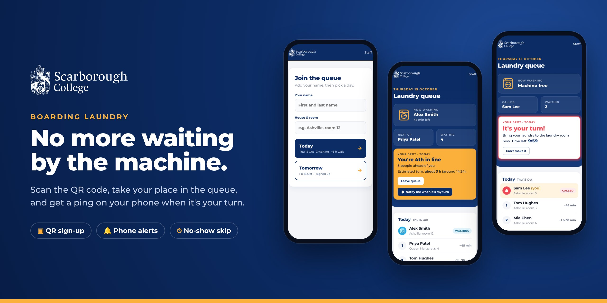
</p>

<h1 align="center">Boarding Laundry Queue</h1>

<p align="center">
  A simple, phone-first laundry queue for <strong>Scarborough College</strong> boarders.<br>
  Scan the QR code in the laundry room, take your place in line, and get a notification when it's your turn.
</p>

<p align="center">
  
  
  
  
</p>

---

## ✨ Features

| | |
|---|---|
| 📷 **QR-code sign-up** | Only students physically in the laundry room can join: they scan the poster on the wall. |
| 📅 **Today or tomorrow** | Join today's queue, or put your name down for tomorrow. At midnight, tomorrow's list becomes today's on its own. |
| 📍 **Your place in line** | "You're 3rd in line, 2 people ahead of you." Your row is highlighted, and the page updates itself. |
| ⏳ **Wait-time estimates** | "Estimated turn: about 1 h 30 min (around 12:49)", plus "45 min left" on the current wash. |
| 🔔 **Phone notifications** | "🧺 It's your turn!" when staff call you, and "✅ Your wash is done" when it's finished. |
| 🙋 **Students run it themselves** | Called students tap **I'm here — start my wash**. When their laundry is out, they tap **I'm done — machine is free**, and the next person is called and notified straight away. Staff only step in when needed. |
| ⏱️ **No-show handling** | Called students have 10 minutes to arrive. If they don't, they move to the back and the next person is called. A second miss takes them off the list. |
| 👆 **One-tap for staff** | **Call next** → **Arrived — start wash** → **Done**. Tapping **Done** calls the next person automatically. |
| 📺 **Laundry room screen** | A full-screen page for a TV or tablet: who's washing, who's called, who's next, a clock and the QR code to join. |
| ⚙️ **Settings page** | Staff set the wash length, time to turn up and a daily sign-up limit, all on the site. |
| 🌙 **Dark mode** | Follows the phone's setting, which is easier on the eyes at night. |
| 🖨️ **Printable poster** | A ready-to-print A4 poster with the QR code. Make a new code at any time to stop old posters and photos of them from working. |
| 🎓 **Scarborough College look** | School logo, navy & gold colours and the Montserrat font. Designed for phones first. |

---

## 📱 For students

<table>
  <tr>
    <td align="center" width="33%">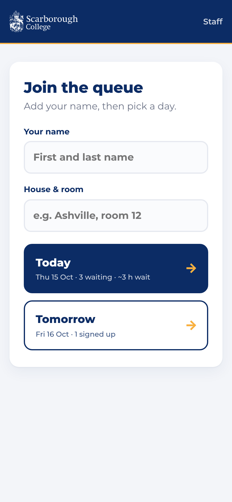</td>
    <td align="center" width="33%">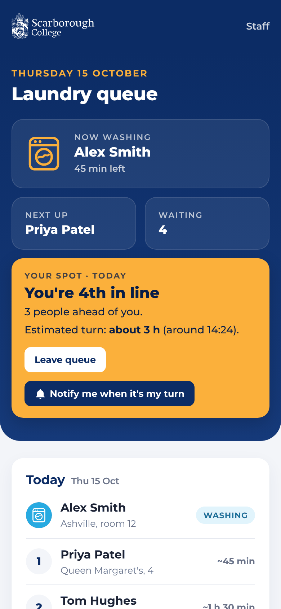</td>
    <td align="center" width="33%">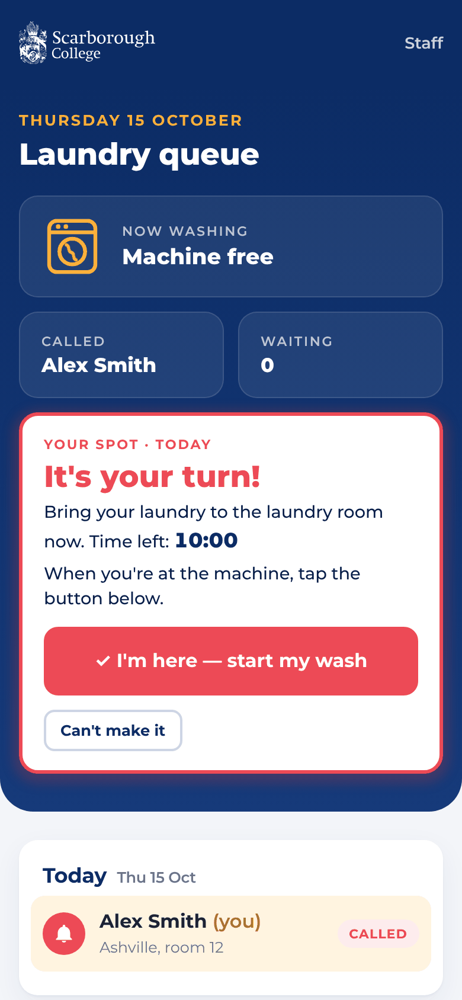</td>
  </tr>
  <tr>
    <td align="center"><strong>1. Scan &amp; join</strong><br><sub>Type your name and house once, then tap <em>Today</em> or <em>Tomorrow</em>. Your details are remembered next time.</sub></td>
    <td align="center"><strong>2. Wait your turn</strong><br><sub>See who's washing, who's next and your place in line. Tap <em>Notify me</em> to get a ping.</sub></td>
    <td align="center"><strong>3. It's your turn!</strong><br><sub>Your phone gets a notification and the page shows a countdown. Tap <em>I'm here</em> at the machine, then <em>I'm done</em> when your laundry is out.</sub></td>
  </tr>
</table>

## 🧑‍🏫 For boarding staff

<table>
  <tr>
    <td width="68%">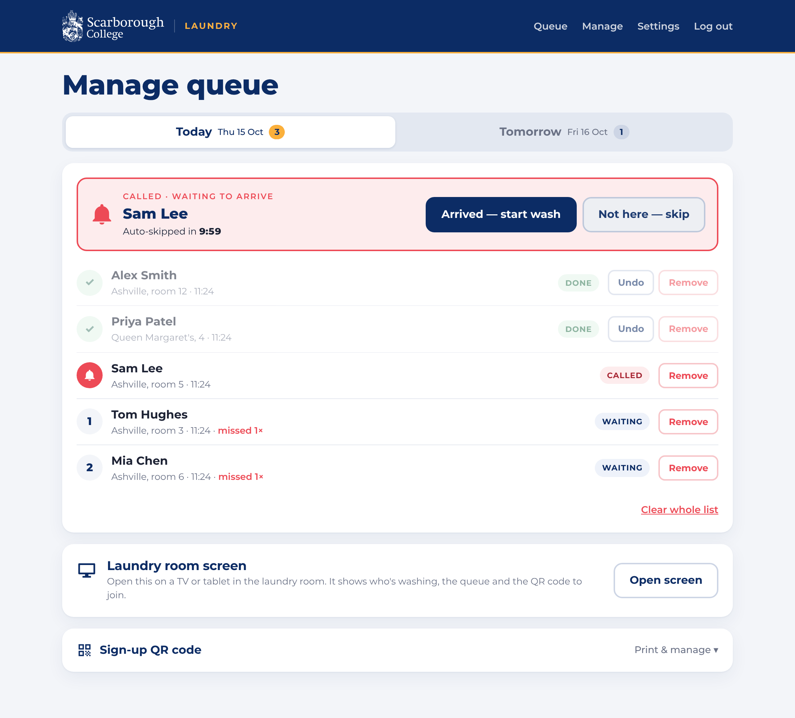</td>
    <td width="32%" align="center">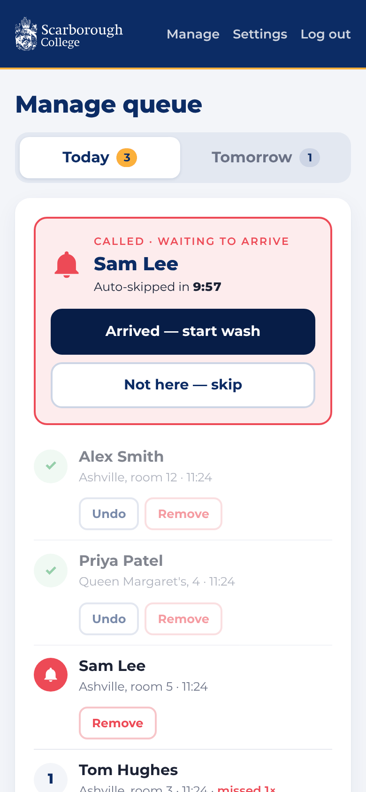</td>
  </tr>
</table>

1. Log in at **`/admin`** with the staff password.
2. Tap **Call next**. The student is notified and has 10 minutes to turn up.
3. When they arrive, tap **Arrived — start wash**. If they don't arrive, tap **Not here — skip** (or let the timer do it).
4. When the wash finishes, tap **Done**. The student is told to collect their laundry, and the next person is called automatically.

Students can do steps 3 and 4 themselves with **I'm here — start my wash** and **I'm done — machine is free** on their phone. When the machine is free and nobody is waiting, a student who scans the code is called straight away. In practice the queue runs by itself, and the staff page is for fixing things: skipping, removing or calling someone.

Today and tomorrow are on separate tabs. Students who have missed a turn are marked (e.g. *missed 1×*).

<table>
  <tr>
    <td width="50%" align="center">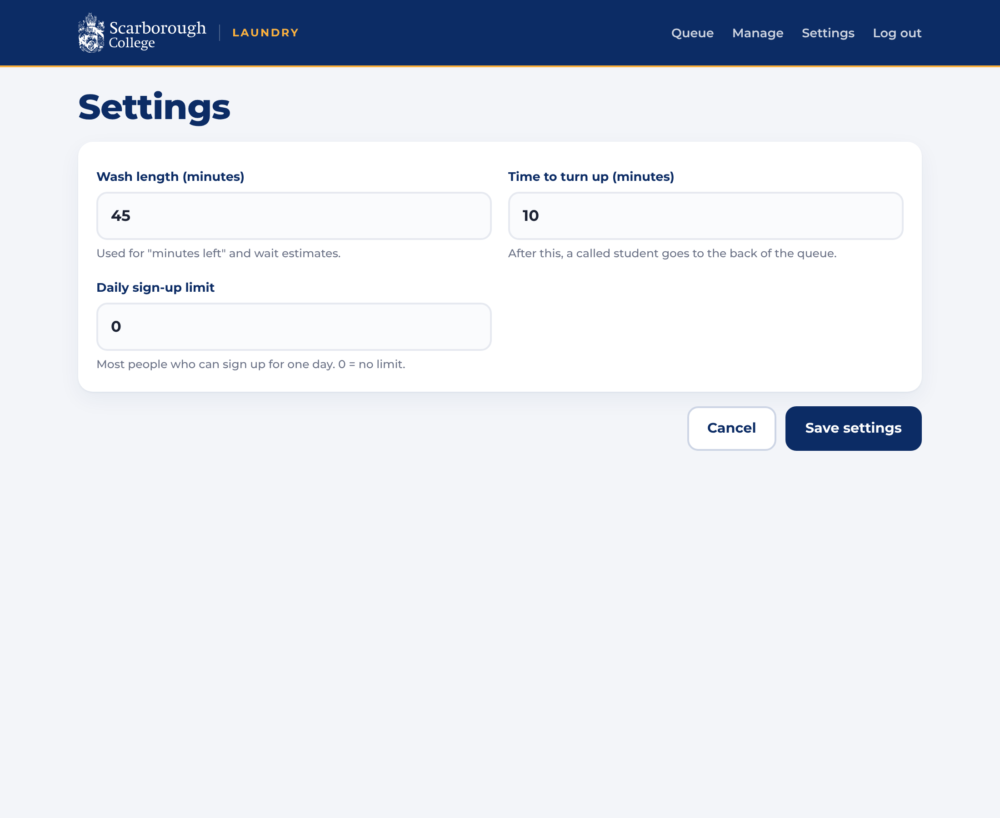<br><sub><strong>Settings</strong>: wash length, time to turn up and a daily limit</sub></td>
    <td width="50%" align="center">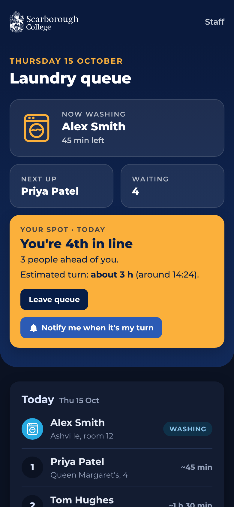<br><sub><strong>Dark mode</strong> follows the phone's setting</sub></td>
  </tr>
</table>

### 📺 Laundry room screen

Put a TV or old tablet in the laundry room and open **Open screen** from the staff page. It shows who's washing and how long is left, who's been called (with a countdown), who's next, a clock and a big QR code to join. It updates by itself.

<p align="center">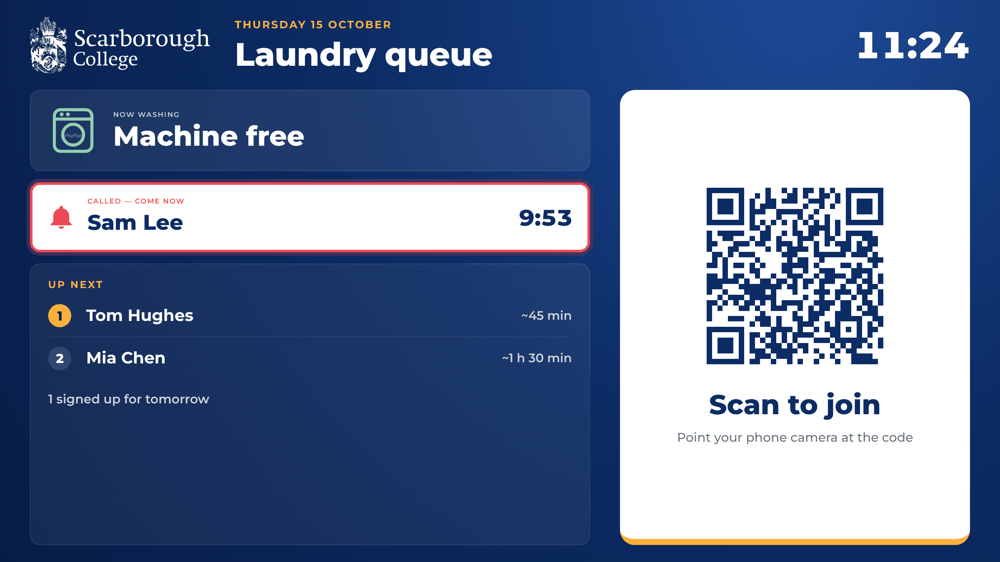</p>

> 🔒 The screen link contains a secret key, because the screen shows the sign-up QR code. Clicking **New code** changes both.

<table>
  <tr>
    <td width="45%" align="center">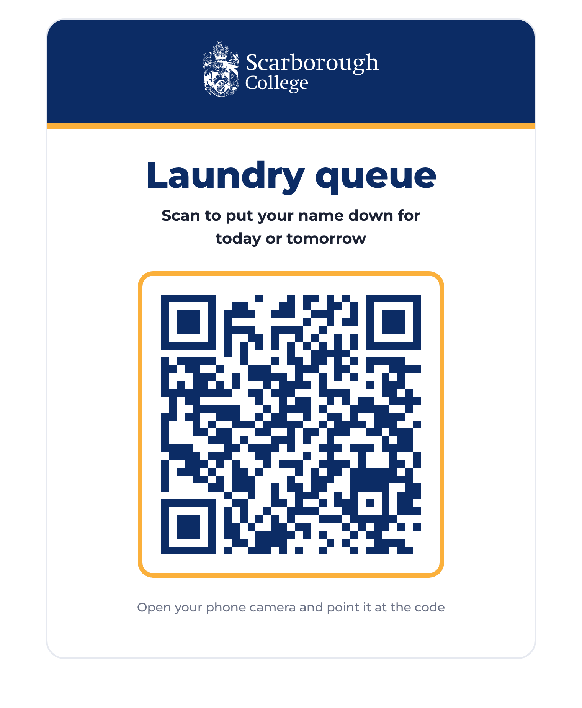</td>
    <td width="55%">
      <h3>🖨️ The QR poster</h3>
      <p>Open <em>Sign-up QR code</em> at the bottom of the staff page and click <strong>Print poster</strong>. Put it up in the laundry room.</p>
      <p>If a photo of the code is being passed around, click <strong>New code</strong>: old posters stop working straight away, and you print a fresh one.</p>
    </td>
  </tr>
</table>

### 💻 Also works on a big screen

<p align="center">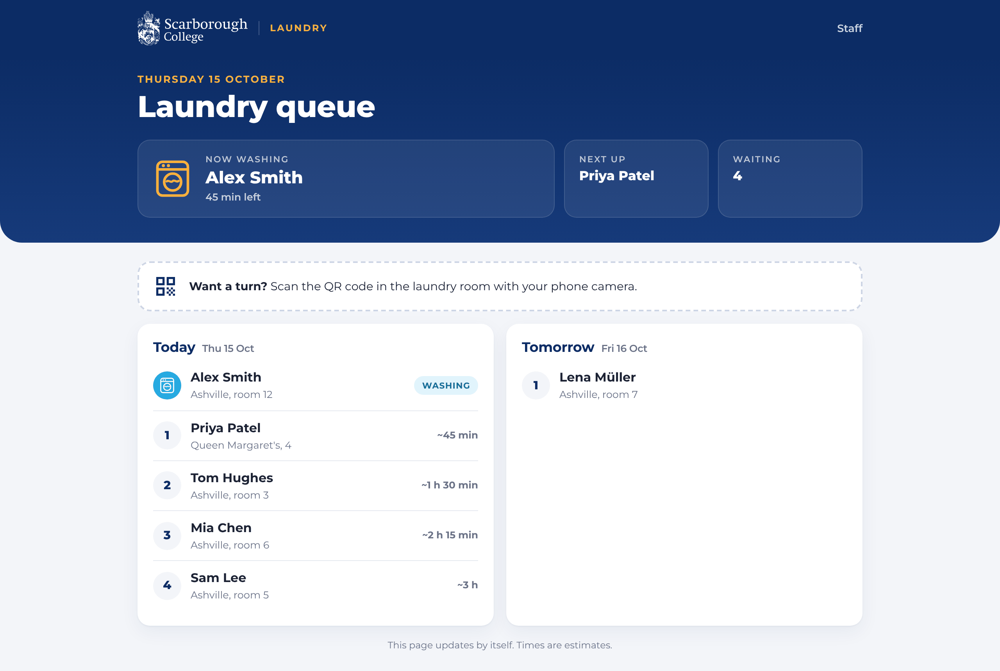</p>

---

## 🚀 Getting started

**You need:** [Node.js](https://nodejs.org) 18 or newer.

```bash
git clone https://github.com/matiua/Laundry-queue-.git
cd Laundry-queue-
npm install
ADMIN_PASSWORD=choose-a-password npm start
```

Open **http://localhost:3000**. Staff log in at **http://localhost:3000/admin**.

### ⚙️ Settings

Day-to-day settings (wash length, time to turn up, daily limit) are on the staff **Settings** page. These variables are set once on the server:

| Variable | Required | What it does |
|---|:---:|---|
| `ADMIN_PASSWORD` | ✅ | Password for the staff page. |
| `PUBLIC_URL` | recommended | The site's public address, e.g. `https://laundry.example.com`. The QR code points here. |
| `VAPID_SUBJECT` | recommended | Contact for the push notification services, e.g. `mailto:boarding@yourschool.co.uk`. |
| `NO_SHOW_MINUTES` | | Starting value for the time to turn up (default `10`). After the first run, change it on the Settings page. |
| `PORT` | | Port to listen on (default `3000`). |

### 🌍 Putting it live

1. Host it anywhere that runs Node.js and keeps files between restarts: a school server, [Render](https://render.com), [Railway](https://railway.app), [Fly.io](https://fly.io), etc.
2. Make sure it's on **HTTPS**. Phone notifications only work over HTTPS.
3. Set `ADMIN_PASSWORD`, `PUBLIC_URL` and `VAPID_SUBJECT`.
4. Log in to `/admin`, print the poster, and stick it up in the laundry room. Done!

> 💾 Everything is saved in `data/db.json`: the queue, the QR code and the notification keys. Keep this folder (or back it up) when you redeploy.

---

## 🔔 About notifications

| Device | How to turn them on |
|---|---|
| **Android** (Chrome, Edge, Firefox, Samsung Internet) | Tap **Notify me when it's my turn** and allow. |
| **iPhone / iPad** (iOS 16.4+) | Tap **Share → Add to Home Screen**, open the queue from the new icon, then tap **Notify me**. Apple only allows notifications for sites on the home screen. The page shows these steps. |
| **Laptop** (Chrome, Edge, Firefox, Safari) | Tap **Notify me** and allow. |

If notifications are off or blocked, the queue still works: the page updates by itself, and it buzzes and turns red when it's your turn.

---

## 🛠️ How it works

```
waiting ──Call next──▶ called ──Arrived / "I'm here"──▶ washing ──Done / "I'm done"──▶ done
   ▲                     │                                  │
   │                     └─ no-show (10 min or "Not here")  └─ next person is
   └──── back of the queue ◀─┘  (2nd miss: removed)            called automatically
```

- **Server:** [Express](https://expressjs.com) with pages built on the server, so it's fast on any phone. Pages still work if JavaScript is turned off.
- **Storage:** a single JSON file, with no database to set up.
- **Notifications:** standard [Web Push](https://developer.mozilla.org/docs/Web/API/Push_API), sent with the [`web-push`](https://github.com/web-push-libs/web-push) library. There's no app to install and no third-party account to set up.
- **Security:** sign-up needs the secret QR token. Staff log in with a password and a signed cookie. Students can only remove their own entry.

```
server.js          routes: queue, join, staff admin, push API
lib/turns.js       queue rules: call, start, finish, skip, no-show timer, wait estimates
lib/store.js       JSON file storage
lib/views.js       HTML pages
public/            styles, logo, service worker, app icons
test/              automated tests (npm test)
```

### 🧪 Tests

```bash
npm test
```

The tests cover QR-only sign-up, one place per phone, leaving the queue, staff login and actions, calling, skipping, the no-show timer, removal after two misses, notifications, wait estimates, the daily limit, settings checks and the laundry room screen link.

---

<p align="center">
  <sub>Made for the boarders of Scarborough College 🧺</sub>
</p>
